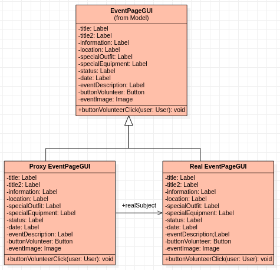
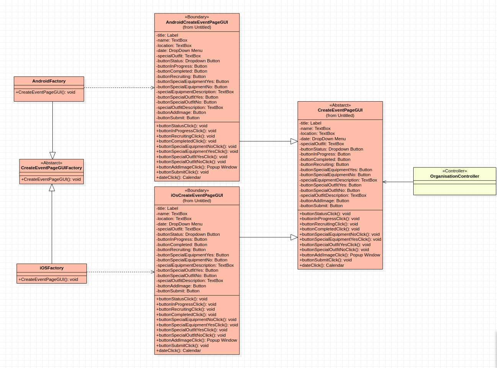
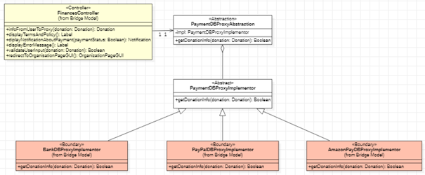

# 5. Design patterns

Section 1 of the group's *Software Specification and System Implementation* (version 1.0, 30 May 2021). Three design patterns were adopted, each to satisfy a specific non-functional requirement (NFR) of [section 1](requirements.md#13-significant-non-functional-requirements):

| Pattern | Family | Satisfies |
|---|---|---|
| [5.1 Virtual Proxy](#51-virtual-proxy) | Structural | [NFR-1](requirements.md#nfr-1) (1000 simultaneous users) and [NFR-3](requirements.md#nfr-3) (home page loads in under 1 second) |
| [5.2 Abstract Factory](#52-abstract-factory) | Creational | [NFR-5](requirements.md#nfr-5) (iOS and Android support) |
| [5.3 Bridge](#53-bridge) | Structural | NFR-9 (current and future payment methods) |

The models of the patterns are in [`uml/patterns/`](../uml/patterns).

## 5.1 Virtual Proxy

NFR-1 and NFR-3 demand speed and the ability to serve many users at the same time. It is therefore necessary that the graphical interfaces (GUIs) of the application load as fast as possible.

The Virtual Proxy pattern gives a solution to this problem. The Virtual Proxy belongs to the family of structural design patterns. An indicative example of its use is the case where the user has a poor internet connection, or where a large number of users are connected to the system. Under these conditions the application may be slow to load the requested page. So, instead of showing an empty screen, the application sends a Proxy object with an abstract representation of what the user is about to see once the real object has loaded. In this way it indirectly tells the user that the page is loading, improving their experience.

The diagram below shows the application of the pattern for the page of a volunteer event (class `EventPageGUI`); its use, however, can be extended to all the GUI classes of the application.

## 5.2 Abstract Factory

NFR-5 requires that the application can be used on different versions of the iOS and Android operating systems and communicate with them. For this purpose we use the creational pattern Abstract Factory. Through it we can have an abstract class for calling the constructors without having implemented the details of the initialisation of each object, which may change depending on the operating system. For example, with the use of the abstract `CreateEventPageGUI`, it becomes possible to access the user's image files and their calendar on various systems.

## 5.3 Bridge

For the needs of the second deliverable a new non-functional requirement is added that did not exist in the original system specification:

### NFR-9

The <ins>system</ins> must support the payment of <ins>donations</ins> through the <ins>payment methods</ins> and new methods that may be added in the future.

**Description:** The donation system must be able to communicate with a variety of different APIs of banks and electronic payment services, so that users can pay donations.

**User priority:** 7/10. It is important for the user to have the choice of several payment methods.

**Technical priority:** 2/10. It is not necessary for the proper functioning of the application.

The requirement is also listed with the other non-functional requirements in [section 1.3.7](requirements.md#137-extensibility-requirements).

The requirement that the system must support payment through various methods, and the ability to add new payment methods in the future, is satisfied by the use of the Bridge pattern.

This pattern belongs to the structural patterns and is implemented by an abstraction class, `PaymentDBProxyAbstraction`. To it will be attached all the classes that implement the payment functions. Because there is only one function shared by the Proxy classes of each payment method, `getDonationInfo()`, there is also an abstract implementation class: `PaymentDBProxyImplementor`. The function of this class takes the information of the donation as it is created by the user and passes it to the API of the corresponding payment service.

All the individual implementations of the function for each payment service exist in the classes `BankDBProxyImplementor`, `PayPalDBProxyImplementor` and `AmazonPayDBProxyImplementor`, or in some new payment-method class that will be added in the future. To achieve this, they inherit the class `PaymentDBProxyImplementor`, but each has its own specialised implementation of `+getDonationInfo()`.

In this way the system gains extensibility, because it is now possible to add new payment methods in the future. Finally, the specialisation into different implementations helps to decouple the payment system from all the other functions of the application, making it easy to maintain.

## Definitions

Three terms of [section 1.4](requirements.md#14-definitions) matter for this section.

| Term | Meaning |
|---|---|
| **Donation** | The user can pay a sum of money to an organisation with a set of <ins>payment methods</ins>. |
| **Payment methods** | All the methods that are available for donating to an organisation through the web application. For the present version these are credit or debit card, PayPal, Amazon Pay or bank transfer. |
| **System** | All the functional parts of the application: the interface and the business logic. |

---

Previous: [4. Static model](static-model.md) · Next: [6. REST API](rest-api.md)
