# 7. Node-RED implementation

Section 3 of the group's *Software Specification and System Implementation* (version 1.0, 30 May 2021): the REST services of [section 6](rest-api.md) built as Node-RED flows on top of a MongoDB database, and how each user story maps onto them. The flows are in [`implementations/node-red/flows.json`](../implementations/node-red/flows.json) and the database that was used in the tests is in [`implementations/node-red/db-seed/`](../implementations/node-red/db-seed). [`implementations/node-red/README.md`](../implementations/node-red/README.md) says what is needed to run them.

## 7.1 Mapping of the REST services to Node-RED flows

Note: for the needs of Node-RED a MongoDB database was used, and the variables `userId`, `organisationId`, `eventId` and `notificationId` were replaced by `username`, `organisationName`, `eventName` and `notificationName` respectively.

### 7.1.1 Data resources

#### Flows of the user resource

**Flow of endpoint `PUT /user/:username`**

The flow that implements the service through which a user can update their own state (identified by the username) in the database.

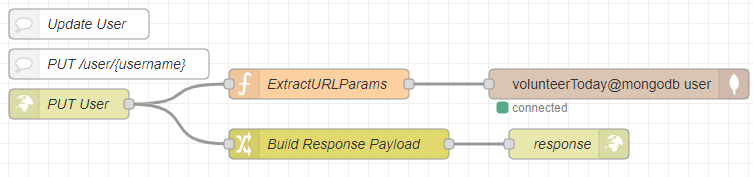

**Flow of endpoint `POST /user`**

The flow that implements the service through which a user can register a new user in the system.

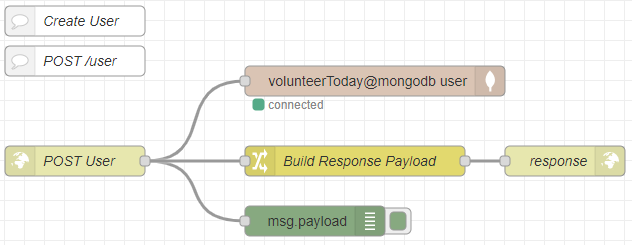

**Flow of endpoint `GET /user/:username`**

The flow that implements the service responsible for returning one specific user to a user or organisation. The function `ExtractURLParams` makes sure that the username is passed on in `msg.payload`, so that it is given as input to the database.

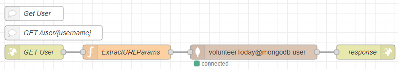

#### Flows of the organisation resource

**Flow of endpoint `POST /organisation`**

The flow that implements the service through which a user can register a new organisation in the system.

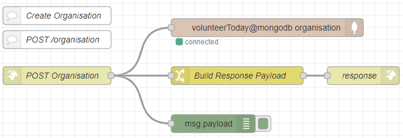

**Flow of endpoint `PUT /organisation/:organisationName`**

The flow that implements the service through which an organisation can update its own state (identified by `organisationName`) in the database.

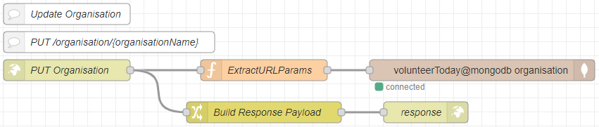

**Flow of endpoint `GET /organisation/:organisationName`**

The flow that implements the service responsible for returning one specific organisation to a user or organisation. The function `ExtractURLParams` makes sure that `organisationName` is passed on in `msg.payload`, so that it is given as input to the database.

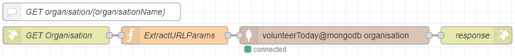

#### Flows of the event resource

**Flow of endpoint `GET /organisation/:organisationName/event/:eventName`**

The flow that implements the service responsible for returning one specific volunteer event to a user or organisation. The function `ExtractURLParams` makes sure that `eventName` is passed on in `msg.payload`, so that it is given as input to the database.

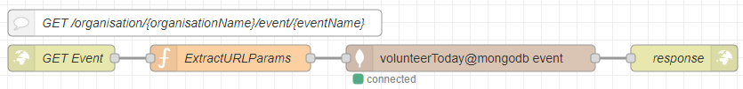

**Flow of endpoint `POST /organisation/:organisationName/event`**

The flow that implements the service through which an organisation can register a new volunteer event in the system.

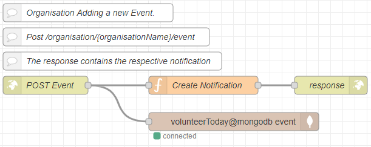

**Flow of endpoint `PUT /organisation/:organisationName/event/:eventName`**

The flow that implements the service through which an organisation can update the state of one of its volunteer events (identified by `organisationName`) in the database.

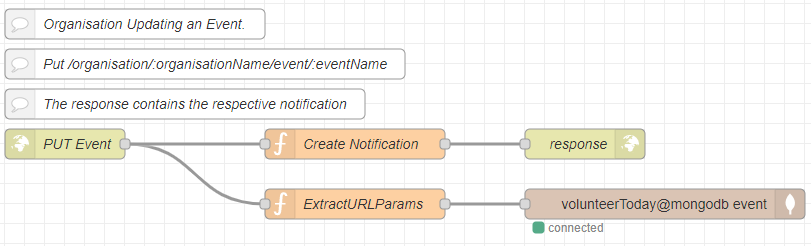

#### Flows of the notification resource

**Flow of endpoint `POST /organisation/:organisationName/event/:eventName/notification`**

The flow that implements the service responsible for returning one specific notification to a user.

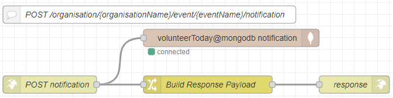

**Flow of endpoint `GET /organisation/:organisationName/event/:eventName/notification/:notificationMessage`**

The flow that implements the service responsible for returning one specific notification to a user.

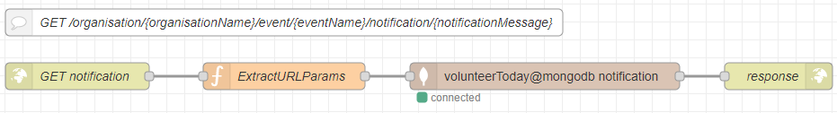

#### Flows of the donation resource

**Flow of endpoint `POST /organisation/:organisationName/donation`**

The flow that implements the service through which a user can make a donation to a specific organisation (identified by `organisationName`) in the database.

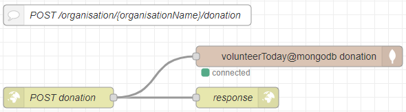

### 7.1.2 Algorithmic resources

#### Flows of the search resource

**Flow of endpoint `GET /search`**

The flow that implements the search service for a user, organisation or event. It takes a keyword as argument and searches the database by name.

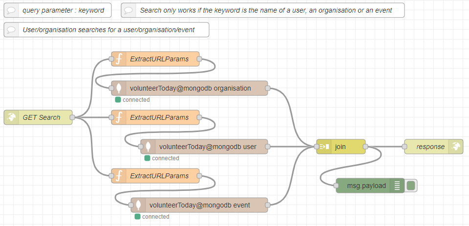

#### Flows of the recommend resource

**Flow of endpoint `GET /user/:username/recommend`**

The flow that implements the service responsible for recommending volunteer events to a user. The function `Recommendation Algorithm` implements the algorithm that matches relevant events to the user. It takes the user's information as argument and returns the names of the volunteer events that are relevant to their interests.

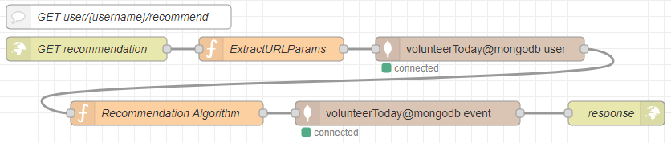

## 7.2 Implementation of the user stories

Each user story is realised by a small flow of an `inject` node, which triggers the run, one or more `http-request` nodes, which call the services above, and a `debug` node, which prints the result.

### 7.2.1 User story: Manage personal information

**User Creates User Account**

A flow through which the user can add themselves as a user of the application.

| Node name | Node type | Description |
|---|---|---|
| Create User | Inject | Used to trigger the execution of the flow. |
| Post User Request | http-request | Calls the service `POST /user`, which lets the user add themselves as a user of the application by entering their details. |
| `msg.statusCode` | debug | Prints to the console the response code of the system to the call of the user. |

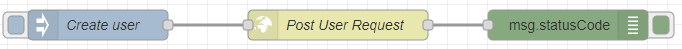

**User Updates User Account**

A flow through which the user can update the details they have registered in the application.

| Node name | Node type | Description |
|---|---|---|
| Update User | Inject | Used to trigger the execution of the flow. |
| Put User Request | http-request | Calls the service `PUT /user/{username}`, which lets the user update the details they have registered. |
| `msg.statusCode` | debug | Prints to the console the response code of the system to the call of the user. |

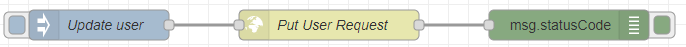

**Organisation Creates Organisation Account**

A flow through which the organisation can be added to the application as an organisation.

| Node name | Node type | Description |
|---|---|---|
| Create organisation | Inject | Used to trigger the execution of the flow. |
| Post Organisation Request | http-request | Calls the service `POST /organisation`, which lets the organisation be added to the application by entering its details. |
| `msg.statusCode` | debug | Prints to the console the response code of the system to the call of the organisation. |

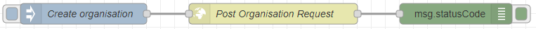

**Organisation Updates Organisation Account**

A flow through which the organisation can update the details it has registered.

| Node name | Node type | Description |
|---|---|---|
| Update organisation | Inject | Used to trigger the execution of the flow. |
| Put Organisation Request | http-request | Calls the service `PUT /organisation/{organisationName}`, which lets the organisation update the details it has registered. |
| `msg.statusCode` | debug | Prints to the console the response code of the system to the call of the organisation. |

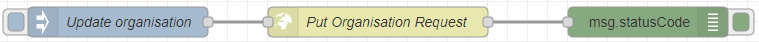

### 7.2.2 User story: View information of organisation or event or user

**User/Organisation Gets User**

A flow through which the user or organisation can see the profile of another user.

| Node name | Node type | Description |
|---|---|---|
| Get User | Inject | Used to trigger the execution of the flow. |
| Get User Request | http-request | Calls the service `GET /user/{username}`, which lets the user see the profile of a specific user by their username. |
| `msg.payload` | debug | Prints to the console the details of the user. |

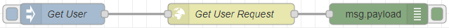

**User/Organisation Gets Organisation**

A flow through which the user or organisation can see the profile of an organisation.

| Node name | Node type | Description |
|---|---|---|
| Get Organisation | Inject | Used to trigger the execution of the flow. |
| Get Organisation Request | http-request | Calls the service `GET /organisation/{organisationName}`, which lets the user or organisation see the details of a specific organisation by its `organisationName`. |
| `msg.payload` | debug | Prints to the console the details of the organisation. |

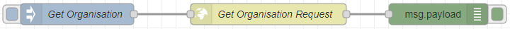

**User/Organisation Gets Event**

A flow through which the user or organisation can see the profile of an organisation.

| Node name | Node type | Description |
|---|---|---|
| Get Event | Inject | Used to trigger the execution of the flow. |
| Get Event Request | http-request | Calls the service `GET /organisation/{organisationName}/event/{eventName}`, which lets the user or organisation see the information of a specific volunteer event by its `eventName`. |
| `msg.payload` | debug | Prints to the console the information of the volunteer event. |

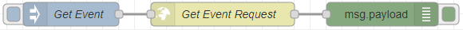

### 7.2.3 User story: Suggest event

**User Gets Recommendation**

A flow through which the user can see recommendations for upcoming Events.

| Node name | Node type | Description |
|---|---|---|
| GET Recommendation | Inject | Used to trigger the execution of the flow. |
| Get Recommendation Request | http-request | Calls the service `GET /user/{username}/recommend`, which lets the user see a list of recommended Events based on their information. |
| `msg.payload` | debug | Prints to the console a list of recommended Events. |

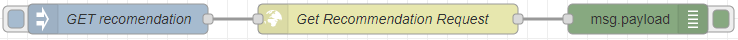

### 7.2.4 User story: Donate to organisation

**User Posts Donation**

A flow through which the user can make donations.

| Node name | Node type | Description |
|---|---|---|
| Post Donation | Inject | Used to trigger the execution of the flow. |
| Donation Post Request | http-request | Calls the service `POST /organisation/{organisationName}/donation`, with which the user creates and makes donations. |
| `msg.payload` | debug | Prints the details of the donation. |

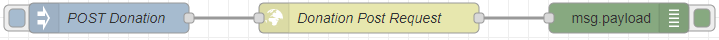

### 7.2.5 User story: Become or Unbecome a volunteer of a current event

A flow through which a user can become a volunteer of an Event or leave it. To implement the flow, the flows of the user stories 7.2.1 (*User Updates User Account*) and 7.2.7 (*Organisation Updates Event*) must be activated.

### 7.2.6 User story: Become or Unbecome member of organisation

A flow through which a user can become a member of an organisation or leave it. To implement the flow, the flows of the user story 7.2.1 (*User Updates User Account* and *Organisation Updates Organisation Account*) must be activated.

### 7.2.7 User story: Create or manage an event

**Organisation Creates Event**

A flow through which the organisation can create an Event.

| Node name | Node type | Description |
|---|---|---|
| Create Event | Inject | Used to trigger the execution of the flow. |
| Post Event Request | http-request | Calls the service `POST /organisation/{organisationName}/event`, which lets the organisation create Events. |
| Post Notification Request | http-request | Calls the service `POST /organisation/{organisationName}/event/}{eventName}/notification`, which lets the organisation create a Notification for the Event that is being created. |
| `msg.statusCode` | debug | Prints the corresponding response code of the system to the call of the organisation. |

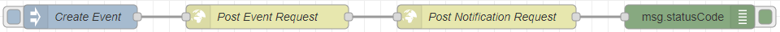

**Organisation Updates Event**

A flow through which the user can update the details of an Event they have created.

| Node name | Node type | Description |
|---|---|---|
| Change Event | Inject | Used to trigger the execution of the flow. |
| Put Event Request | http-request | Calls the service `PUT /organisation/{organisationName}/event/{eventName}`, which lets the organisation change the information of the Event. |
| Post Notification Request | http-request | Calls the service `POST organisation/{organisationName}/event/{eventName}/notification`, which lets the organisation create a Notification for the Event that is being created. |
| `msg.statusCode` | debug | Prints the corresponding response code of the system to the call of the organisation. |

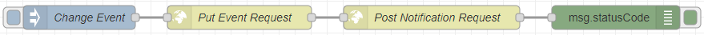

**User Gets Notification**

A flow through which Notifications are created.

| Node name | Node type | Description |
|---|---|---|
| GET Notification | Inject | Used to trigger the execution of the flow. |
| Get Notification Request | http-request | Calls the service `POST /organisation/{organisationName}/event/{eventName}/notification`, which creates Notifications. |
| `msg.payload` | debug | Prints to the console the Notification object. |

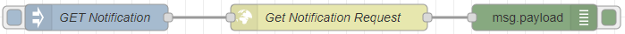

### 7.2.8 User story: Search for an organisation or event or user

**User/Organisation searches for User/Organisation/Event**

A flow through which a user, an event or an organisation is searched for.

| Node name | Node type | Description |
|---|---|---|
| Search | Inject | Used to trigger the execution of the flow. |
| Search Request | http-request | Calls the service `GET /search`, with which a user, an organisation or a volunteer event is searched for by the `username`, the `organisationName` or the `eventName` respectively. |
| `msg.payload` | debug | Prints to the console a list of objects of type user, organisation and volunteer event that match the `username`, `organisationName` or `eventName` that was searched for. |

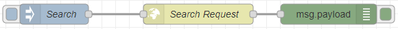

---

Previous: [6. REST API](rest-api.md) · Back to the [README](../README.md)
