# 4. Static model

The class model of VolunteerToday, as documented in section 4 of the group's *User Requirements and System Specification* (version 2.0, 11 April 2021). The model is divided into packages. Every package holds classes of three kinds, shown as stereotypes in the diagrams:

- **Boundary** classes: the interface screens and components, and the proxies that connect the system to external services (Google, Facebook and the payment services).
- **Entity** classes: the data the system keeps (user, organisation, event, notification, donation).
- **Controller** classes: the logic that connects the other two.

The packages are grouped by the priority of the scenarios whose vocabulary they carry: seven packages for high-priority scenarios (4.1), one for medium priority (4.2) and one for low priority (4.3). For every class the page gives its UML box, a description, its attributes and its methods; each package ends with its class diagram.

## 4.1 Vocabulary packages of high-priority scenarios

### 4.1.1 Login Package

This package contains the classes related to the requirement that the user be able to manage information about themselves.

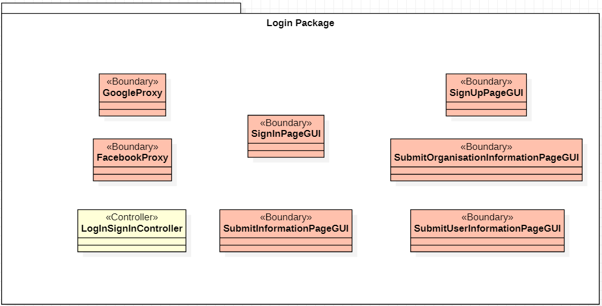

#### Boundary GoogleProxy

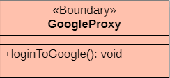

This class represents the proxy that ensures the user's login through their Google account.

**<ins>Class methods:</ins>**

- `loginToGoogle(): void`: logs the user in through their Google account.

#### Boundary FacebookProxy

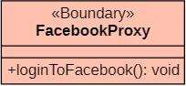

This class represents the proxy that ensures the user's login through their Facebook account.

**<ins>Class methods:</ins>**

- `loginToFacebook(): void`: logs the user in through their Facebook account.

#### Boundary SignInPageGUI

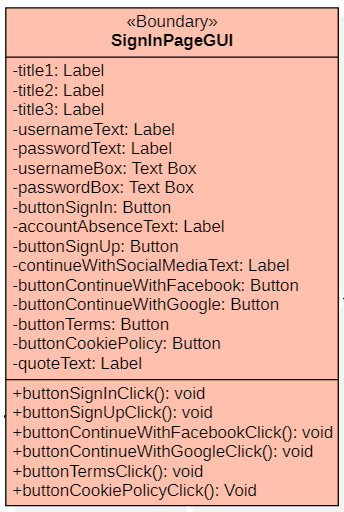

This class represents the interface where the user signs in to the application.

**<ins>Class attributes:</ins>**

- `title1: Label`: the first heading on the application's login page.
- `title2: Label`: the second heading on the login page.
- `title3: Label`: the third heading on the login page.
- `usernameText: Label`: the title of the text box for entering the username.
- `passwordText: Label`: the title of the text box for entering the user's password.
- `usernameBox: Text Box`: the text box where the user enters their username.
- `passwordBox: Text Box`: the text box where the user enters their password.
- `buttonSignIn: Button`: the button the user presses to sign in to the application.
- `accountAbsenceText: Label`: the fourth heading on the login page.
- `buttonSignUp: Button`: the button the user presses to sign up to the application.
- `continueWithSocialMediaText: Label`: the fifth heading on the login page.
- `buttonContinueWithFacebook: Button`: the button the user presses to sign in through their Facebook account.
- `buttonContinueWithGoogle: Button`: the button the user presses to sign in through their Google account.
- `buttonTerms: Button`: the button the user presses to read the web app's terms of use.
- `buttonCookiePolicy: Button`: the button the user presses to read the web app's cookie policy.
- `quoteText: Label`: the sixth heading on the login page.

**<ins>Class methods:</ins>**

- `buttonSignInClick(): void`: calls the `signIn()` function of the controller `LogInSignInController` and leads to the user's sign-in to the application.
- `buttonSignUpClick(): void`: calls the `signUp()` function of the controller `LogInSignInController` and leads to the user's sign-in to the application.
- `buttonContinueWithFacebookClick(): void`: calls the `redirectToFacebook()` function of the controller `LogInSignInController` and leads to the user's sign-in to the application.
- `buttonContinueWithGoogleClick(): void`: calls the `redirectToGoogle()` function of the controller `LogInSignInController` and leads to the user's sign-in to the application.
- `buttonTermsClick(): void`: creates the interface that shows the terms of use.
- `buttonCookiePolicyClick(): void`: creates the interface that shows the cookie policy.

#### Boundary SubmitInformationPageGUI

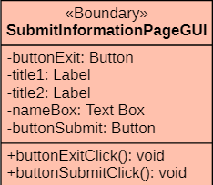

This class represents the part of the interface where the user fills in their details, whether they are an individual or an organisation.

**<ins>Class attributes:</ins>**

- `buttonExit: Button`: the button the user presses to return to the LogInPageGUI.
- `title1: Label`: the first heading on the login page.
- `title2: Label`: the second heading on the login page.
- `nameBox: Text Box`: the text box where the user enters their name.
- `buttonSubmit: Button`: the button the user presses to submit their details.

**<ins>Class methods:</ins>**

- `buttonExitClick(): void`: calls the `closeSubmitInfoWindow()` function of the controller `LogInSignInController` and returns the user to the LogInPageGUI.
- `buttonSubmitClick(): void`: calls the `signUp()` function of the controller `LogInSignInController` and signs the user up to the application.

#### Boundary SignUpPageGUI

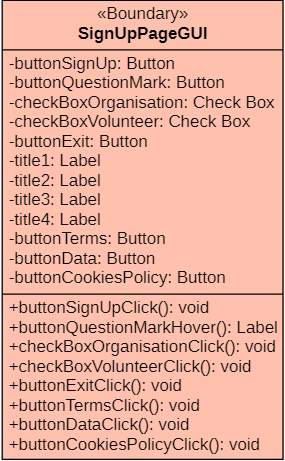

This class represents the interface where the user signs up to the application.

**<ins>Class attributes:</ins>**

- `buttonSignUp: Button`: the button the user presses to sign up.
- `buttonQuestionMark: Button`: the button the user presses to learn about the different kinds of account.
- `checkBoxOrganisation: Check Box`: the check box the user ticks to define their account as a volunteer organisation.
- `checkBoxVolunteer: Check Box`: the check box the user ticks to define their account as a volunteer.
- `buttonExit: Button`: the button the user presses to return to the LogInPageGUI.
- `title1: Label`: the first heading on the SignUp page of the app.
- `title2: Label`: the second heading on the SignUp page.
- `title3: Label`: the third heading on the SignUp page.
- `title4: Label`: the fourth heading on the SignUp page.
- `buttonTerms: Button`: the button the user presses to read the web app's terms of use.
- `buttonData: Button`: the button the user presses to read the web app's data policy.
- `buttonCookiePolicy: Button`: the button the user presses to read the web app's cookie policy.

**<ins>Class methods:</ins>**

- `buttonSignUpClick(): void`: calls the `editInformation()` function of the controller `LogInSignInController` and leads to the interface for filling in the user's details.
- `buttonQuestionMarkHover(): Label`: calls the `popUpProfileType()` function of the controller `LogInSignInController` and shows the user the differences between the two profile types.
- `checkBoxOrganisationClick(): void`: defines the user's account as an organisation.
- `checkBoxVolunteerClick(): void`: defines the user's account as a volunteer.
- `buttonExitClick(): void`: calls the `closeSubmitInfoWindow()` function of the controller `LogInSignInController` and returns the user to the LogInPageGUI.
- `buttonTermsClick(): void`: creates the interface that shows the terms of use.
- `buttonDataClick(): void`: creates the interface that shows the data policy.
- `buttonCookiePolicyClick(): void`: creates the interface that shows the cookie policy.

#### Boundary SubmitOrganisationInformationPageGUI

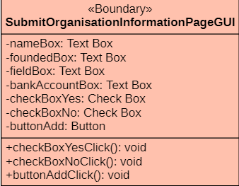

This class represents the interface where the organisation fills in its details.

**<ins>Class attributes:</ins>**

- `nameBox: Text Box`: the text box where the organisation enters its name.
- `foundedBox: Text Box`: the text box where the organisation enters its year of founding.
- `fieldBox: Text Box`: the text box where the organisation enters its field of activity.
- `bankAccountBox: Text Box`: the text box where the organisation enters its bank account.
- `checkBoxYes: Check Box`: the check box the user ticks to accept donations.
- `checkBoxNo: Check Box`: the check box the user ticks to not accept donations.
- `buttonAdd: Button`: the button the organisation presses to add a bank account.

**<ins>Class methods:</ins>**

- `checkBoxYesClick(): void`: sets the account as open to donations.
- `checkBoxNoClick(): void`: sets the account as closed to donations.
- `buttonAddClick(): void`: adds the organisation's bank account.

#### Boundary SubmitUserInformationPageGUI

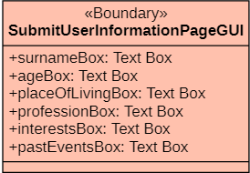

This class represents the interface where the user fills in their details.

**<ins>Class attributes:</ins>**

- `surnameBox: Text Box`: the text box where the user enters their surname.
- `ageBox: Text Box`: the text box where the user enters their age.
- `placeOfLivingBox: Text Box`: the text box where the user enters their place of living.
- `professionBox: Text Box`: the text box where the user enters their profession.
- `interestsBox: Text Box`: the text box where the user enters their interests.
- `pastEventBox: Text Box`: the text box where the user enters their past events.

#### Controller LogInSignInController

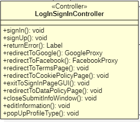

This class represents the controller for creating the interfaces that deal with the sign-in and sign-up of users and organisations.

**<ins>Class methods:</ins>**

- `signIn(): void`: lets the user sign in.
- `signUp(): void`: lets the user sign up.
- `returnError(): Label`: shows an error message.
- `redirectToGoogle(): GoogleProxy`: redirects to the Google account login window.
- `redirectToFacebook(): GoogleProxy`: redirects to the Facebook account login window.
- `redirectToTermsPage(): void`: redirects to a window with the terms of use.
- `redirectToCookiePolicyPage(): void`: redirects to a window with the cookie policy.
- `exitToSignInPageGUI(): void`: redirects to the signInGUI interface.
- `redirectToDataPolicyPage(): void`: redirects to a window with the data policy.
- `closeSubmitInfoWindow(): void`: redirects to the signInGUI interface.
- `editInformation(): void`: redirects to the details interface, `SubmitUserInformationPageGUI` or `SubmitOrganisationInformationPageGUI`, depending on whether the account is a user or an organisation.
- `popUpProfileType(): void`: shows an informative message about the kinds of account.

**<ins>Class diagram:</ins>**

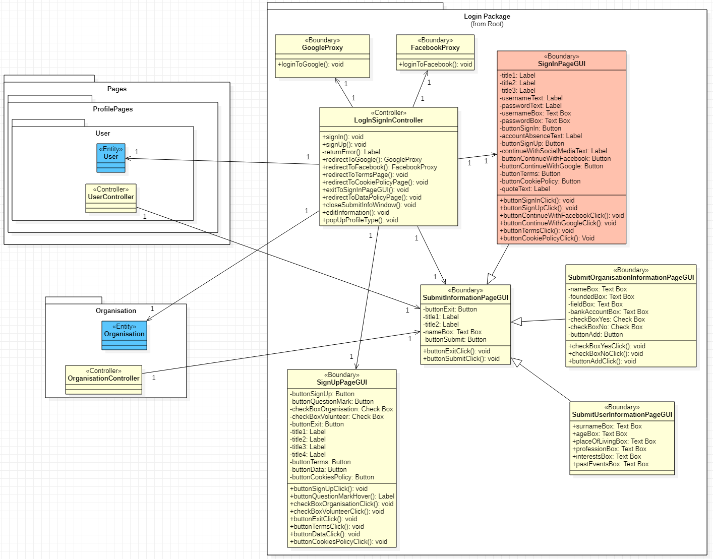

### 4.1.2 User Package

This package contains the classes related to the requirement that the user or organisation be able to see the information of a user.

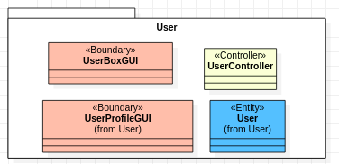

#### Entity User

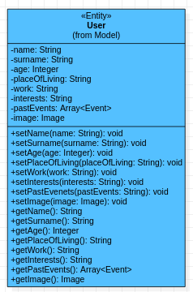

This class represents the user and holds all the information that belongs to the user.

**<ins>Class attributes:</ins>**

- `name: String`: the user's name.
- `surname: String`: the user's surname.
- `age: Integer`: the user's age.
- `placeOfLiving: String`: the user's place of residence.
- `work: String`: the user's work.
- `interests: String`: the user's interests.
- `pastEvents: Array<Event>`: earlier events in which the user took part as a volunteer.
- `image: Image`: the photo the user uses as their profile picture.

**<ins>Class methods:</ins>**

- `setName(name: String): void`: sets the user's name.
- `setSurname(surname: String): void`: sets the user's surname.
- `setAge(age: Integer): void`: sets the user's age.
- `setPlaceOfLiving(placeOfLiving: String): void`: sets the user's place of residence.
- `setWork(work: String): void`: sets the user's work.
- `setInterests(interests: String): void`: sets the user's interests.
- `setPastsEvents(pastEvents: String): void`: sets the earlier events in which the user took part.
- `getName(): String`: returns the user's name.
- `getSurname(): String`: returns the user's surname.
- `getAge(): Integer`: returns the user's age.
- `getPlaceOfLiving(): String`: returns the user's place of residence.
- `getWork(): String`: returns the user's work.
- `getInterests(): String`: returns the user's interests.
- `getPastEvents(): String`: returns an array of objects of type Event.
- `getImage(): Image`: returns the user's image.

#### Boundary UserProfileGUI

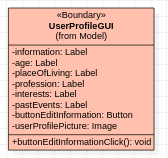

This class represents the user's profile interface, shown when a user's profile is visited.

**<ins>Class attributes:</ins>**

- `information: Label`: the heading a visitor sees on the user's profile, in the box above the user's information.
- `age: Label`: the user's age.
- `placeOfLiving: Label`: the user's place of residence.
- `profession: Label`: the user's profession.
- `interests: Label`: the user's interests.
- `pastEvents: Label`: the earlier events in which the user took part.
- `buttonEditInformation: Button`: a button that, when pressed, lets the user change the data shown on their profile.
- `userProfilePicture: Image`: the user's profile picture.

**<ins>Class methods:</ins>**

- `buttonEditInformationClick: void`: calls the controller method `openSubmitInformationPageGUI(user: User)`, which leads to the display of the `SubmitUserInformationPageGUI` interface.

#### Boundary UserBoxGUI

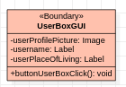

This class represents the user's profile interface as it appears in a search.

**<ins>Class attributes:</ins>**

- `userProfilePicture: Image`: the user's profile picture.
- `username: Label`: the user's name.
- `userPlaceOfLiving: Label`: the user's place of residence.

**<ins>Class methods:</ins>**

- `buttonUserBoxClick(): void`: if someone clicks on this object, the method `redirectToUser(userBox: UserBoxGUI)` of the controller `PageController` is called, which redirects to the user's profile.

#### Controller UserController

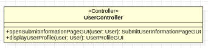

This controller holds the functions that let the user edit their information from their profile, and make their page visible to other users and organisations.

**<ins>Class methods:</ins>**

- `openSubmitInformationPageGUI(user: User): SubmitUserInformationPageGUI`: called whenever the user wants to change their details.
- `displayUserProfile(user: User): UserProfileGUI`: called whenever someone visits the user's profile page.

**<ins>Class diagram:</ins>**

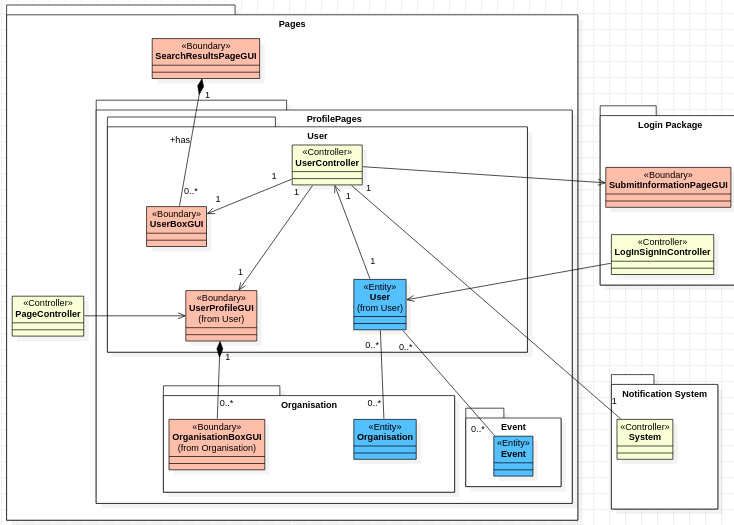

### 4.1.3 Organisation Package

This package contains the classes related to the requirement that the user or organisation be able to see the information of an organisation.

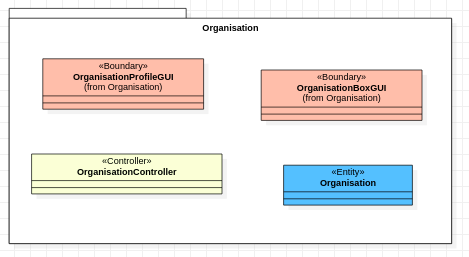

#### Entity Organisation

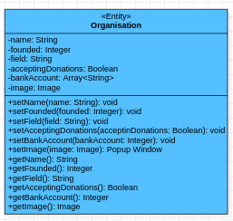

This class represents the organisation and holds all the information that belongs to the organisation.

**<ins>Class attributes:</ins>**

- `name: String`: the organisation's name.
- `founded: Integer`: the year the organisation was founded.
- `field: String`: the field in which the organisation operates.
- `acceptingDonations: Boolean`: a boolean variable that is true if the organisation accepts donations and false if it does not.
- `bankAccount: Array<String>`: the numbers of the bank accounts.
- `image: Image`: the organisation's profile picture.

**<ins>Class methods:</ins>**

- `setName(name: String): void`: sets the organisation's name.
- `setFounded(founded: Integer): void`: sets the year the organisation was founded.
- `setField(field: String): void`: sets the field in which the organisation operates.
- `setAcceptingDonations(acceptingDonations: Boolean): void`: sets the variable `acceptingDonations`.
- `setBankAccount(bankAccount: Integer): void`: sets the numbers of the organisation's bank accounts.
- `setImage(image: Image): Popup Window`: sets the organisation's profile picture.
- `getName(): String`: returns the user's name.
- `getFounded(): Integer`: returns the year the organisation was founded.
- `getField()`: returns the organisation's field of activity.
- `getAcceptingDonations(): Boolean`: returns the variable `acceptingDonations`.
- `getBankAccount(): Integer`: returns the organisation's bank account.
- `getImage(): Image`: returns the organisation's image.

#### Boundary OrganisationPorfileGUI

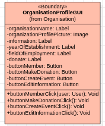

This class represents the profile interface, shown when the corresponding profile is visited.

**<ins>Class attributes:</ins>**

- `organisationName: Label`: the organisation's name.
- `organisationPorfilePicture: Image`: the organisation's profile picture.
- `information: Label`: the heading a visitor sees on the profile, in the box above the information.
- `yearOfEstablishment: Label`: the year the organisation was established.
- `fieldOfEmployment: Label`: the field in which the organisation operates.
- `donate: Label`: whether or not the organisation accepts donations.
- `buttonMember: Button`: a button with which the user can become a member of an organisation or leave it.
- `buttonMakeDonation: Button`: a button that redirects the user to a page where they can make a donation.
- `buttonCreateEvent: Button`: a button that redirects the user to a page for creating a new Event.
- `buttonEditInformation: Button`: a button for editing the organisation's information.

**<ins>Class methods:</ins>**

- `buttonMemberClick(user: User): void`: calls the controller method `manageMember`, which registers the user with the organisation or removes them from it.
- `buttonCreateEventClick(): void`: calls `redirectToCreateEventPageGUI()`, which redirects the organisation to the Event creation page.
- `buttonMakeDonationClick(): void`: calls the controller method `redirectToDonationPageGUI()`, which redirects the user to the donation page.
- `buttonEditInformationClick(): void`: lets the organisation manage its information by calling the controller method `openSubmitInformationPageGUI()`.

#### Boundary OrganisationBoxGUI

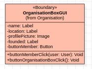

This class represents the organisation's profile interface as it appears in a search.

**<ins>Class attributes:</ins>**

- `name: Label`: the organisation's name.
- `location: Label`: the organisation's location.
- `profilePicture: Image`: the organisation's profile picture.
- `founded: Label`: the date the organisation was founded.
- `buttonMember: Button`: a button with which the user can become a member of an organisation or leave it.

**<ins>Class methods:</ins>**

- `buttonMemberClick(user: User): void`: calls the controller method `manageMember`, which registers the user with the organisation or removes them from it.
- `buttonOrganisationBoxClick(): void`: if someone clicks on this object, the method `redirectToOrganisation(organisationBox: OrganisationBoxGUI)` of the controller `PageController` is called, which redirects to the organisation's profile.

#### Controller OrganisationController

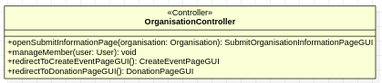

This controller implements methods for managing the organisation's information, redirecting to the organisation's page and redirecting to the Event creation page.

**<ins>Class methods:</ins>**

- `openSubmitInformationPage(organisation: Organisation): SubmitOrganisationInformationPageGUI`: lets the organisation edit its information through the `SubmitOrganisationInformationPageGUI`.
- `manageMember(user: User): void`: called when a user becomes a member or leaves.
- `redirectToCreateEventPageGUI(): CreateEventPαgeGUI`: redirects to the Event creation page.
- `redirectToDonationPageGUI(): DonationPageGUI`: redirects to the page where a donation is made.

**<ins>Class diagram:</ins>**

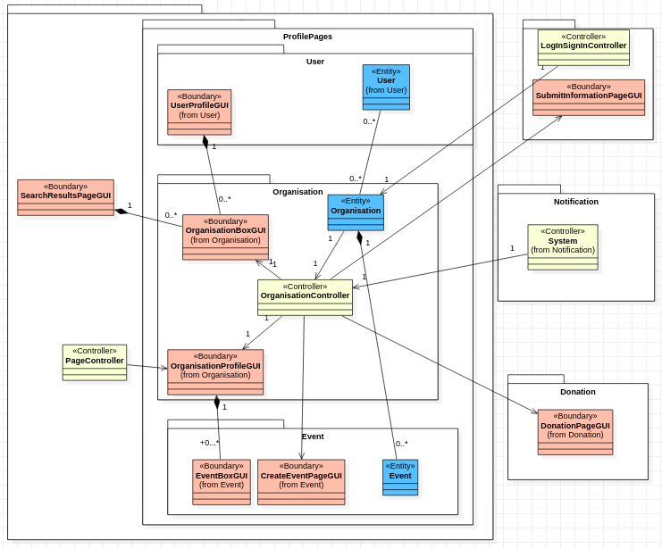

### 4.1.4 Event Package

This package contains the classes related to the requirement that the user or organisation be able to see the information of an event, and to create and edit it.

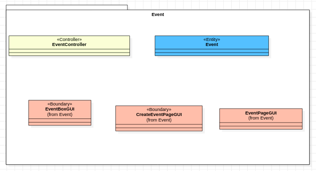

#### Entity Event

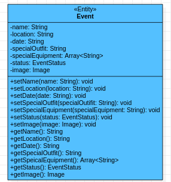

This class represents the volunteer event and holds all the information that belongs to it.

**<ins>Class attributes:</ins>**

- `name: String`: the Event's name.
- `location: String`: the Event's location.
- `date: String`: the date on which the Event will take place.
- `specialOutfit: String`: a description of the special clothing required to take part in the Event.
- `specialEquipment: Array<String>`: a description of the special equipment required to take part in the Event.
- `status: EventStatus`: the state the Event is in; it takes one of 3 values: in progress, recruiting, completed.
- `image: Image`: the Event's image.

**<ins>Class methods:</ins>**

- `setName(name: String): void`: sets the Event's name.
- `setLocation(location: String): void`: sets the Event's location.
- `setDate(date: String): void`: sets the Event's date.
- `setSpecialEquipment(specialEquipment: String): void`: sets the special equipment required for the Event.
- `setStatus(status: EventStatus): void`: returns the Event's status.
- `setImage(image: Image): void`: sets the Event's image.
- `getName(): String`: returns the Event's name.
- `getLocation(): String`: returns the Event's location.
- `getDate(): String`: returns the Event's date.
- `getSpecialEquipment(): String`: returns the special equipment required for the Event.
- `getStatus(): EventStatus`: returns the Event's status.
- `getImage(): Image`: returns the Event's image.

#### Boundary CreateEventPageGUI

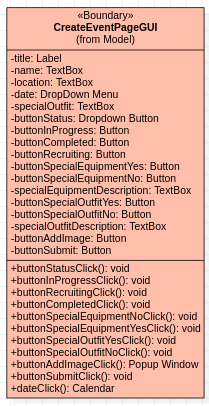

This class is required for the interface for creating an Event.

**<ins>Class attributes:</ins>**

- `title: Label`: the heading "Create a new event".
- `name: Text Box`: the Event's name.
- `location: Text Box`: the Event's location.
- `date: DropDown Button`: the Event's date.
- `specialOutfit: TextBox`: the special clothing required for the Event.
- `buttonStatus: Button`: a DropDown Menu for choosing one of the 3 statuses for the Event: inProgress, completed, recruiting.
- `buttonInProgress`: a button that selects the status InProgress.
- `buttonCompleted`: a button that selects the status Completed.
- `buttonRecruiting`: a button that selects the status Recruiting.
- `buttonSpecialEquipmentYes`: a button that selects that special equipment will be used.
- `buttonSpecialEquipmentNo`: a button that selects that no special equipment will be used.
- `specialEquipmentDescription`: a description of the special equipment to be used, if it is required.
- `buttonSpecialOutfitYes`: a button that selects that special clothing will be used.
- `buttonSpecialOutfitNo`: a button that selects that no special clothing will be used.
- `specialOutfitDescription`: a description of the special clothing to be used, if it is required.
- `buttonAddImageClick`: a button with which a profile picture for the Event can be uploaded.
- `buttonSubmit`: a button used to submit the Event's details.

**<ins>Class methods:</ins>**

- `buttonStatusClick(): void`: shows the DropDown Button with which the user selects the status.
- `buttonInProgressClick(): void`: sets the variable `status` to the value inProgress.
- `buttonRecruitingClick(): void`: sets the variable `status` to the value recruiting.
- `buttonCompletedClick(): void`: sets the variable `status` to the value completed.
- `buttonSpecialEquipmentNoClick(): void`: sets the variable `specialEquipment` to the value False.
- `buttonSpecialEquipmentYesClick(): void`: sets the variable `specialEquipment` to the value True.
- `buttonSpecialOutfitYesClick(): void`: sets the variable `specialOutfit` to the value True.
- `buttonSpecialOutfitNoClick(): void`: sets the variable `specialOutfit` to the value False.
- `buttonAddImageClick(): Popup Window`: returns a popup from which the user can upload an image.
- `buttonSubmitClick(): void`: saves the data above in an object of the class Event.
- `dateClick(): void`: returns a Calendar from which the user can choose the date on which the Event takes place.

#### Boundary EventPageGUI

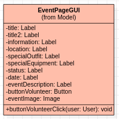

This class represents the Event's profile interface, shown when the corresponding Event page is visited.

**<ins>Class attributes:</ins>**

- `title: Label`: the heading "Event Description".
- `title2: Label`: the heading "Other Similar Events".
- `information: Label`: the heading "Information".
- `location: Label`: the Event's location.
- `specialOutfit: Label`: the special clothing required for the Event.
- `specialEquipment: Label`: the special equipment required for the Event.
- `status: Label`: the Event's status.
- `date: Label`: the Event's date.
- `eventDescription: Label`: the Event's description.
- `buttonVolunteer: Button`: a button with which the user can become a volunteer in this Event or leave it.
- `eventImage: Image`: the Event's profile picture.

**<ins>Class methods:</ins>**

- `buttonVolunteerClick(user: User): void`: calls the method `manageVolunteer(user: User)`, which adds a user as a volunteer in the Event.

#### Boundary EventBoxGUI

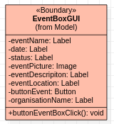

This class represents the organisation's profile interface as it appears in a search.

**<ins>Class attributes:</ins>**

- `eventName: Label`: the Event's name.
- `date: Label`: the date on which the Event takes place.
- `eventPicture: Image`: the Event's profile picture.
- `eventDescription: Label`: the Event's description.
- `eventLocation: Label`: the Event's location.
- `buttonEvent: Button`: a button that redirects to the Event's page.
- `organisationName: Label`: the name of the organisation that organises the Event.

**<ins>Class methods:</ins>**

- `buttonEventBoxClick(): void`: if someone clicks on this object, the method `redirectToEvent(eventBox: EventBoxGUI)` of the controller `PageController` is called, which redirects to the Event's profile.

#### Controller EventController

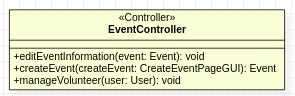

**<ins>Class methods:</ins>**

- `editEventInformation(event: Event): void`: lets the organisation edit the information of the Event it has created.
- `createEvent(createEvent: CreateEventPageGUI): Event`: creates an object of type Event after the organisation has submitted its details.
- `manageVolunteer(user: User): void`: called to add the user to the Event as a volunteer.

**<ins>Class diagram:</ins>**

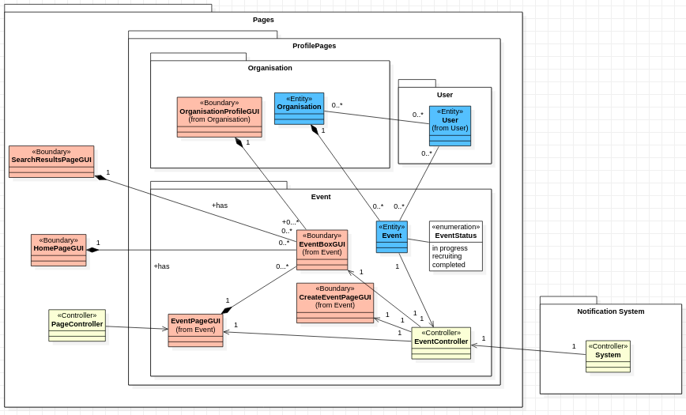

### 4.1.5 ProfilePage Package

This package contains the User Package, the Organisation Package and the Event Package. The ProfilePage Package is the core of the application.

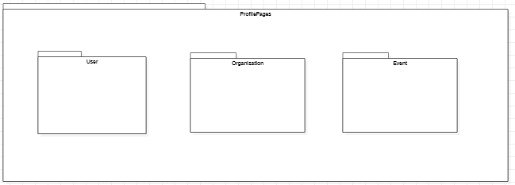

### 4.1.6 Pages Package

This package contains the classes related to the system's interfaces.

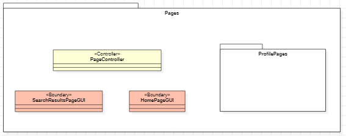

#### Boundary HomePageGUI

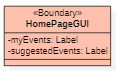

**<ins>Class attributes:</ins>**

- `myEvents: Label`: the title of the `EventBoxGUI` objects that follow.
- `suggestedEvents: Label`: the title of the `EventBoxGUI` objects that follow.

#### Boundary SearchResultsGUI

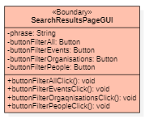

**<ins>Class attributes:</ins>**

- `phrase: String`: the phrase the user searched for.
- `buttonFilterAll: Button`: the button that filters and shows all the results.
- `buttonFilterEvents: Button`: the button that filters the results so that only the volunteer events related to the phrase `phrase` are shown.
- `buttonFilterOrganisations: Button`: the button that filters the results so that only the organisations related to the phrase `phrase` are shown.
- `buttonFilterPeople: Button`: the button that filters the results so that only the users related to the phrase `phrase` are shown.

**<ins>Class methods:</ins>**

- `buttonFilterAllClick(): void`: calls the functions `searchEvent(keyword: String): Array<Event>`, `searchOrganisation(keyword: String): Array<Organisation>` and `searchUser(keyword: String): Array<User>` of the controller `HeaderController`.
- `buttonFilterEventsClick(): void`: calls the function `searchEvent(keyword: String): Array<Event>` of the controller `HeaderController`.
- `buttonFilterOrganisationsClick(): void`: calls the function `searchOrganisation(keyword: String): Array<Organisation>` of the controller `HeaderController`.
- `buttonFilterPeopleClick(): void`: calls the function `searchUser(keyword: String): Array<User>` of the controller `HeaderController`.

#### Controller PagesController

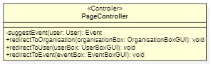

**<ins>Class methods:</ins>**

- `suggestEvent(user: User): Event`: runs the algorithm that finds current volunteer events that could interest the user, based on their information.
- `redirectToOrganisation(organisasionBox: OrganisationBoxGUI): void`: redirects the user to the organisation profile `OrganisationProfileGUI` that corresponds to the argument `organisationBox`.
- `redirectToUser(userBox: UserBoxGUI): void`: redirects the user to the user profile `UserProfileGUI` that corresponds to the argument `userBox`.
- `redirectToEvent(eventBox: EventBoxGUI): void`: redirects the user to the volunteer event page `EventPageGUI` that corresponds to the argument `eventBox`.

**<ins>Class diagram:</ins>**

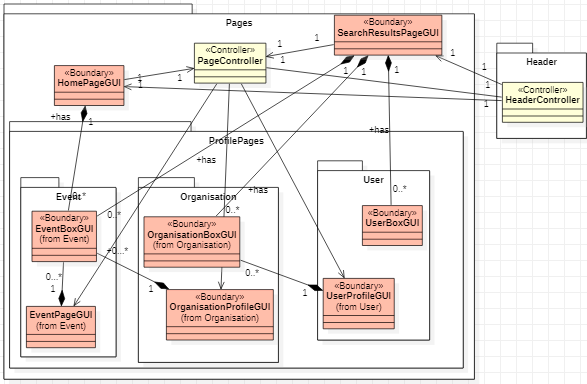

### 4.1.7 Header Package

This package contains the classes that make up the structure of the interface's header.

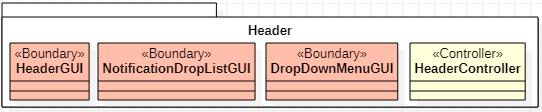

#### Boundary HeaderGui

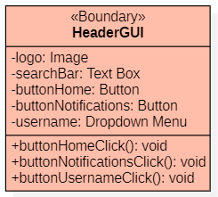

This class expresses the interface of the header at the top of every screen.

**<ins>Class attributes:</ins>**

- `logo: Image`: an icon with the application's logo.
- `searchBar: TextBox`: the text box in which the user enters the phrase they want to search for.
- `buttonHome: Button`: the button the user presses to go to the home page.
- `buttonNotifications: Button`: the button the user presses to open the card with the notifications.
- `username: Dropdown Menu`: the button with the user's name, pressed to show the DropDownMenu.

**<ins>Class methods:</ins>**

- `buttonHomeClick(): void`: calls the function `redirectToHomepageGUI()` of the controller `HeaderController` and returns the user to the home page.
- `buttonNotificationsClick(): void`: calls the function `displayNotifications()` of the controller `HeaderController` and returns a `NotificationDropListGUI`, which is shown to the user.
- `buttonUsernameClick(): void`: calls the function `displayDropDownMenuGUI()` of the controller `HeaderController` and returns a `DropDownMenuGUI`, which is shown to the user.

#### DropDownMenuGUI

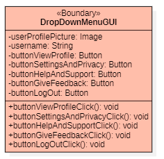

This class expresses the interface of the menu that appears when the user presses their name in the header of the page they are on.

**<ins>Class attributes:</ins>**

- `userProfilePicture: Image`: the photo the user uses as their profile picture.
- `username: String`: the user's name.
- `buttonViewProfile: Button`: the button that redirects the user to their profile page.
- `buttonSettingsAndPrivacy: Button`: the button that redirects the user to the settings and data protection page.
- `buttonGiveFeedback: Button`: the button that redirects the user to the page where they can give us feedback about the application's functions.
- `buttonHelpAndSupport: Button`: the button that redirects the user to the help and support page.
- `buttonLogOut: Button`: the button that signs the user out of the application and returns them to the `SignInPageGUI`.

**<ins>Class methods:</ins>**

- `buttonViewProfile(): void`: calls the function `redirectToProfilePageGUI()` of the controller `HeaderController`.
- `buttonSettingsAndPrivacyClick(): void`: calls the function `redirectToSettingsAndPrivacyPageGUI()` of the controller `HeaderController`.
- `buttonHelpAndSupportClick(): void`: calls the function `redirectToHelpAndSupportPageGUI()` of the controller `HeaderController`.
- `buttonGiveFeedbackClick(): void`: calls the function `redirectToGiveFeedbackPageGUI()` of the controller `HeaderController`.
- `buttonLogOutClick(): void`: calls the function `redirectToSIngInPageGUI()` of the controller `HeaderController` and signs the user out of the application.

#### NotitficationDropListGUI

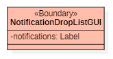

This class expresses the interface of the card with the notifications that appears when the user presses the Notifications button in the header of the page they are on.

**<ins>Class attributes:</ins>**

- `notifications: Label`: the title of the card with the notifications.

#### Controller HeaderController

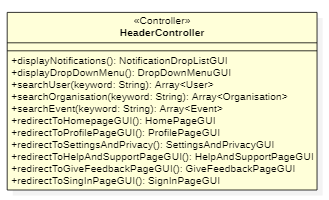

This controller holds the functions for the user's correct interaction with the header of the interface pages.

**<ins>Class methods:</ins>**

- `displayNotifications(): NotificationDropListGUI`: shows the user the card of notifications.
- `displayDropDownMenu(): DropDownMenuGUI`: shows the user the `DropDownMenuGUI` menu.
- `searchUser(keyword: String): Array<User>`: runs the search algorithm to match users to the phrase `keyword` and returns an array of `User` objects.
- `searchOrganisation(keyword: String): Array<Organisation>`: runs the search algorithm to match organisations to the phrase `keyword` and returns an array of `Organisation` objects.
- `searchEvent(keyword: String): Array<Event>`: runs the search algorithm to match volunteer events to the phrase `keyword` and returns an array of `Event` objects.
- `redirectToHomepageGUI(): HomePageGUI`: redirects the user to the home page `HomePageGUI`.
- `redirectToProfilePageGUI(): ProfilePageGUI`: redirects the user to their profile page `ProfilePageGUI`.
- `redirectToSettingsAndPrivacyPageGUI(): SettingsAndPrivacyPageGUI`: redirects the user to the settings and data protection page `SettingsAndPrivacyPageGUI`.
- `redirectToHelpAndSupportPageGUI(): HelpAndSupportPageGUI`: redirects the user to the help and support page `HelpAndSupportPageGUI`.
- `redirectToGiveFeedbackPageGUI(): GiveFeedbackPageGUI`: redirects the user to the page where they can give us feedback about the application's functions, `GiveFeedbackPageGUI`.

**<ins>Class diagram:</ins>**

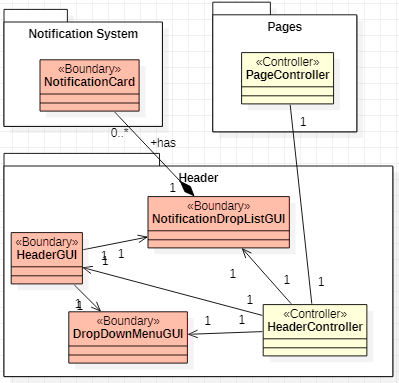

## 4.2 Vocabulary package of medium-priority scenarios

### 4.2.1 Notification Package

This package contains the classes related to the notifications the user receives inside the web app.

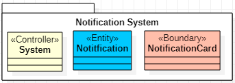

#### Controller System

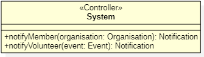

This class represents the part of the system that acts to send notifications to users inside the application.

**<ins>Class methods:</ins>**

- `notifyMember(organisation: Organisation): Notification`: takes an argument of type `Organisation` and sends a notification to all the volunteers of an organisation.
- `notifyVolunteer(event: Event): Notification`: takes an argument of type `Event` and sends a notification to all the volunteers of an event.

#### Entity Notification

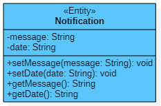

This class represents the part of the system that implements the notification sent after an action.

**<ins>Class attributes:</ins>**

- `message: String`: the message the notification contains.
- `date: String`: the date the notification was sent.

**<ins>Class methods:</ins>**

- `setMessage(message: String): void`: sets the notification's message.
- `setDate(date: String): void`: sets the notification's date.
- `getMessage(): void`: returns the notification's message.
- `getDate(): void`: returns the notification's date.

#### Boundary NotificationCard

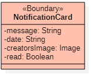

This class represents the part of the system that implements the notification card shown to the user.

**<ins>Class attributes:</ins>**

- `message: String`: the message the notification card contains.
- `date: String`: the date the notification card was sent.
- `creatorsImage: Image`: the image of the user or organisation whose action caused the notification to be sent.
- `read: Boolean`: a variable that defines whether the user has read the notification.

**<ins>Class diagram:</ins>**

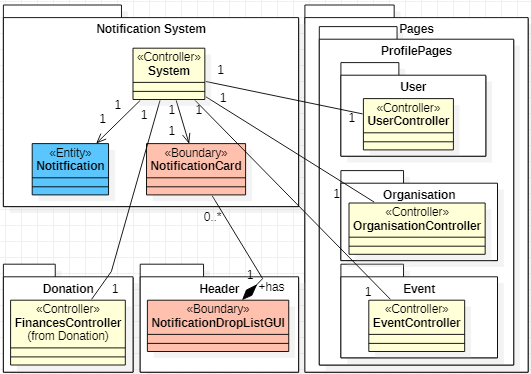

## 4.3 Vocabulary package of low-priority scenarios

### 4.3.1 Donation Package

This package contains the classes that implement the donations that users make to organisations.

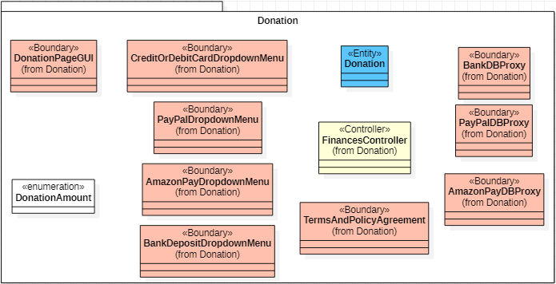

#### Entity Donation

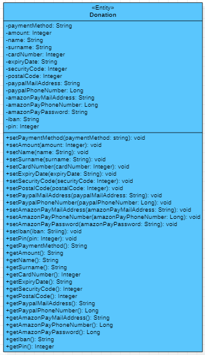

**<ins>Class attributes:</ins>**

- `paymentMethod: String`: the payment method the user has chosen for a donation.
- `amount: Integer`: the amount the user wants to pay as a donation.
- `name: String`: the name the user has given to identify the donation. For a card payment it must be the cardholder's name as printed on the card.
- `surname: String`: the surname the user has given to identify the donation. For a card payment it must be the cardholder's surname as printed on the card.
- `cardNumber: Integer`: the user's card number, if they choose to donate by credit or debit card.
- `expiryDate: String`: the expiry date of the credit or debit card.
- `securityCode: String`: the card's security code. It has three or four digits and is typically printed on the back of the card.
- `postalCode: Integer`: the postal code the user has given to the bank that issued the card.
- `paypalMailAddress: String`: the email address the user uses for transactions through the PayPal service.
- `paypalPhoneAddress: Long`: the phone number the user uses for transactions through the PayPal service.
- `amazonPayMailAddress: String`: the email address the user uses for transactions through the Amazon Pay service.
- `amazonPayPhoneNumber: Long`: the phone number the user uses for transactions through the Amazon Pay service.
- `amazonPayPassword: String`: the user's password for transactions through the Amazon Pay service.
- `iban: String`: the IBAN of the user's bank account.
- `pin: Integer`: the PIN of the user's bank account.

**<ins>Class methods:</ins>**

- `setPaymentMethod(paymentMethod: String): void`: sets the payment method.
- `setAmount(amount: Integer): void`: sets the donation amount.
- `setName(name: String): void`: sets the name of the user making the donation.
- `setSurname(surname: String): void`: sets the surname of the user making the donation.
- `setCardNumber(cardNumber: Long): void`: sets the card number.
- `setExpiryDate(expiryDate: String): void`: sets the card's expiry date.
- `setSecurityCode(securityCode: Integer): void`: sets the card's security code.
- `setPostalCode(postalCode: Integer): void`: sets the user's postal code.
- `setPaypalMailAddress(paypalMailAddress: String): void`: sets the email address the user gives to the PayPal service.
- `setPaypalPhoneNumber(paypalPhoneNumber: Long): void`: sets the phone number the user gives to the PayPal service.
- `setAmazonPayMailAddress(amazonPayMailAddress: String): void`: sets the email address the user gives to the Amazon Pay service.
- `setAmazonPayPhoneNumber(amazonPayPhoneNumber: Long): void`: sets the phone number the user gives to the Amazon Pay service.
- `setAmazonPayPassword(amazonPayPassword: String): void`: sets the user's account password for the Amazon Pay service.
- `setIban(iban: Long): void`: sets the IBAN of the user's bank account.
- `setPin(pin: Integer): void`: sets the PIN of the user's bank account.
- `getPaymentMethod(): String`: returns the payment method.
- `getAmount(): Integer`: returns the donation amount.
- `getName(): String`: returns the name of the user making the donation.
- `getSurname(): String`: returns the surname of the user making the donation.
- `getCardNumber(): Long`: returns the card number.
- `getExpiryDate(): String`: returns the card's expiry date.
- `getSecurityCode(): Integer`: returns the card's security code.
- `getPostalCode(): Integer`: returns the user's postal code.
- `getPaypalMailAddress(): String`: sets the email address the user gives to the PayPal service.
- `getPaypalPhoneNumber(): Long`: returns the phone number the user gives to the PayPal service.
- `getAmazonPayMailAddress(): String`: returns the email address the user gives to the Amazon Pay service.
- `getAmazonPayPhoneNumber(): Long`: returns the email address the user gives to the Amazon Pay service.
- `getAmazonPayPassword(): String`: returns the user's account password for the Amazon Pay service.
- `getIban(): Long`: returns the IBAN of the user's bank account.
- `getPin(): Integer`: returns the PIN of the user's bank account.

#### Boundary DonationPageGUI

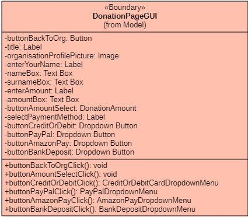

**<ins>Class attributes:</ins>**

- `buttonBackToOrg: Button`: the button for returning to the organisation's page.
- `title: Label`: the title of the payment system's interface page.
- `organisationProfilePicture: Image`: the image of the organisation receiving the donation.
- `enterYourName: Label`: a prompt asking the user to enter their full name.
- `nameBox: Text Box`: the box for entering the user's name.
- `surnameBox: Text Box`: the box for entering the user's surname.
- `enterAmount: Label`: a prompt asking the user to enter their full name.
- `amountBox: Text Box`: the box for entering the user's donation amount.
- `buttonAmountSelect: DonationAmount`: suggested amounts the user can donate.
- `selectpaymentMethod: Label`: a prompt asking the user to choose a payment method.
- `buttonCreditOrDebit: Dropdown Button`: the button for donating by card.
- `buttonPayPal: Dropdown Button`: the button for donating through the PayPal service.
- `buttonAmazonPay: Dropdown Button`: the button for donating through the Amazon Pay service.
- `buttonBankDeposit: Dropdown Button`: the button for donating by a deposit into an account.

**<ins>Class methods:</ins>**

- `buttonBackToOrgClick(): void`: when the user presses the button `buttonbackoOrg`, it activates `redirectToOrganisationPageGUI(): OrganisationPageGUI` of the class `FinancesController`.
- `buttonAmountSelectClick(): void`: when a suggested donation amount is pressed, it selects the corresponding amount.
- `buttonCreditOrDebitClick(): CreditOrDebitDropdownMenu`: returns the drop-down menu related to donating by card.
- `buttonPayPalClick(): PayPalDropdownMenu`: returns the drop-down menu related to donating through the PayPal service.
- `buttonAmazonPayClick(): AmazonPayDropdownMenu`: returns the drop-down menu related to donating through the Amazon Pay service.
- `buttonBankDepositClick(): BankDepositDropdownMenu`: returns the drop-down menu related to donating by a deposit into an account.

#### Enumeration Amount

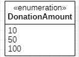

Holds the suggested donation amounts for the organisation: €10, €50 and €100.

#### Boundary CreditOrDebitCardDropdownMenu

**<ins>Class attributes:</ins>**

- `cardLogo: Array<Image>`: images of the logos of the cards supported for donations.
- `cardNumber: Label`: a heading marking the box for entering the card number.
- `cardNumberBox: Text Box`: a box that takes the card number from the user.
- `expiryDate: Label`: a heading marking the box for entering the card's expiry date.
- `expiryDateBox: Text Box`: a box that takes the card's expiry date from the user.
- `securityCode: Label`: a heading marking the box for entering the card's security number.
- `securityCodeBox: Text Box`: a box that takes the card's security code from the user.
- `buttonSecurityCodeQuestionMark: Button`: a button explaining the term security code of the card.
- `zipOrPostalCode: Label`: a heading marking the box for entering the card's security number.
- `zipOrPostalCodeBox: Text Box`: a box that takes the postal code the cardholder has registered.
- `buttonZipOrPostalCodeQuestionMark: Button`: a button explaining the term postal code (ZIP or Postal code) at which the cardholder is registered.

**<ins>Class methods:</ins>**

- `creditOrDebitError(paymentStatus: Boolean): void`: activates `displayErrorMessage(): Label` of the class `FinancesController` in these cases: if this payment method is not available for the organisation, or if the user made an error entering the details. It is also activated when the transaction did not succeed.
- `securityCodeQuestionMarkHover(): Label`: activated when the user hovers the mouse over the button `buttonSecurityCodeQuestionMark`, and returns an explanatory note on the term security code.
- `zipOrPostalCodeQuestionMark(): Label`: activated when the user hovers the mouse over the button `buttonZipOrPostalCodeQuestionMark`, and returns an explanatory note on the term postal code (ZIP or Postal Code).

#### Boundary PayPalDropdownMenu

**<ins>Class attributes:</ins>**

- `payPalLogo`: the logo of the PayPal service.
- `payPalEmailAddress`: a heading marking the box for entering the PayPal email address.
- `payPalEmailAddressBox`: a box that takes the email address the user has registered with the PayPal service.
- `payPalPhoneNumber`: a heading marking the box for entering the phone number the user uses to connect to their PayPal account.
- `payPalPhoneNumberBox`: a box that takes the phone number the user uses to connect to their PayPal account.

**<ins>Class methods:</ins>**

- `PayPalError(paymentStatus: Boolean): Label`: activates `displayErrorMessage(): Label` of the class `FinancesController` in these cases: if this payment method is not available for the organisation, or if the user made an error entering the details. It is also activated when the transaction did not succeed.

#### Boundary AmazonPayDropdownMenu

**<ins>Class attributes:</ins>**

- `amazonPayErrorMessage: Label`: a message that tells the user the Amazon Pay account details were entered wrongly or the transaction failed.
- `amazonPayEmailOrPhoneNumber: Label`: a heading showing the user the box for entering the email address or phone number registered on their Amazon Pay account.
- `amazonPayEmailOrPhoneNumberBox: TextBox`: a box for entering the email address or phone number the user has registered on their Amazon Pay account.
- `amazonPayPassword: Label`: a heading showing the user the box for entering their password on their Amazon Pay account.
- `amazonPayPasswordBox: Text Box`: a box for entering the user's password on their Amazon Pay account.

**<ins>Class methods:</ins>**

- `amazonPayError(paymentStatus; Boolean): void`: activates `displayErrorMessage(): Label` of the class `FinancesController` in these cases: if this payment method is not available for the organisation, or if the user made an error entering the details. It is also activated when the transaction did not succeed.

#### Boundary BankDepositDropdownMenu

**<ins>Class attributes:</ins>**

- `iban: Label`: a heading showing the user the box for entering the IBAN of their bank account.
- `ibanBox: Text Box`: a box for entering the IBAN of the user's bank account.
- `pin: Label`: a heading showing the user the box for entering the PIN of their bank account.
- `pinBox: Text Box`: a box for entering the PIN of the user's bank account.

**<ins>Class methods:</ins>**

- `bankDepositError(paymentMethod: Boolean): Label`: activates `displayErrorMessage(): Label` of the class `FinancesController` in these cases: if this payment method is not available for the organisation, or if the user made an error entering the details. It is also activated when the transaction did not succeed.

#### Boundary TermsAndPolicyAgreement

**<ins>Class attributes:</ins>**

- `agreeToTermsAndPolicy: Label`: a short text of agreement with the application's terms of use (Terms) and policy (Policy).
- `agreeToTermsAndPolicyBox: Check Box`: the check box the user ticks to declare their agreement with the application's terms of use and policy.
- `buttonLearnMore: Button`: the button the user presses to learn more about the application's terms of use (Terms) and policy (Policy).
- `buttonCompleteDonation: Button`: the button that completes the donation.
- `confirmationPopUp: PopUp Window`: a small window confirming the donation.
- `confirmationText: Label`: a short text confirming the donation.
- `buttonYes: Button`: the button for final acceptance and completion of the donation.
- `buttonNo: Button`: the button that suspends the donation process.

**<ins>Class methods:</ins>**

- `agreeToTermsAndPolicyBoxClick(): void`: activated when the corresponding check box is ticked. It is a precondition for completing the donation.
- `buttonCompleteDonationClick(): PopUpWindow`: activated when the button `buttonCompleteDonation` is pressed, and makes the `confirmationPopUp` appear.
- `buttonLearnMoreClick(): void`: activates the function `displayTermsAndConditions(): Label` of the class `FinancesController`.
- `buttonYesClick(): void`: completes the donation on the user's side when the button `buttonYes` is pressed. It activates `infoFromUserToProxy(donation: Donation): Donation` of the class `FinancesController`.
- `buttonNoClick(): void`: suspends the process of making the donation. Activated when the user presses the button `buttonNo`.

#### Boundary BankDBProxy

**<ins>Class methods:</ins>**

- `getDonationInfo(donation: Donation): Boolean`: the external system, having received the information from `infoFromUserToProxy(donation: Donation): Donation` of the class `FinancesController`, enters the details and identifies the user, and tells us whether the donation succeeded or failed.

#### Boundary PayPalDBProxy

**<ins>Class methods:</ins>**

- `getDonationInfo(donation: Donation): Boolean`: the external system, having received the information from `infoFromUserToProxy(donation: Donation): Donation` of the class `FinancesController`, enters the details and identifies the user, and tells us whether the donation succeeded or failed.

#### Boundary AmazonPayDBProxy

**<ins>Class methods:</ins>**

- `getDonationInfo(donation: Donation): Boolean`: the external system, having received the information from `infoFromUserToProxy(donation: Donation): Donation` of the class `FinancesController`, enters the details and identifies the user, and tells us whether the donation succeeded or failed.

#### Controller FinancesController

**<ins>Class methods:</ins>**

- `infoFromUserToProxy(donation: Donation): Donation`: takes the payment information, creates a `Donation` object and sends the object it created to the proxy indicated by the value of the variable `paymentMethod`. The method is activated by the corresponding method `buttonYesClick()` of the class `TermsAndPolicyAgreement`.
- `displayTermsAndPolicy(): Label`: returns text with the application's terms.
- `displayNotificationAboutPayment(paymentStatus: Booolean): Notification`: returns an appropriate notification depending on the type of value returned by `getDonationInfo(donation: Donation): Boolean` of the proxy that corresponds to the chosen payment method (for example, that of the `BankDBProxy` if `paymentMethod` is BankDeposit).
- `displayErrorMessage(): Label`: informs the user with an appropriate message if this donation method is not supported by the organisation, or if there was an error entering the details. It is also responsible for informing the user if the transaction fails after communication with the proxy of the corresponding payment method.
- `validateUserInput(donation: Donation): Boolean`: checks the values the user entered and, if it finds an error in the details, activates `displayErrorMessage(): Label` to show an appropriate message.
- `redirectToOrganisationPageGUI(): OrganisationPageGUI`: returns the user to the organisation's page.

**<ins>Class diagram:</ins>**

## Appendix I: Glossary of notation

- **FR-n**: a functional requirement with its reference number (see [1. System requirements](requirements.md)).
- **NFR-n**: a non-functional requirement with its reference number.

---

Previous: [3. UI mock-ups](ui-mockups.md) · Next: [5. Design patterns](design-patterns.md)
