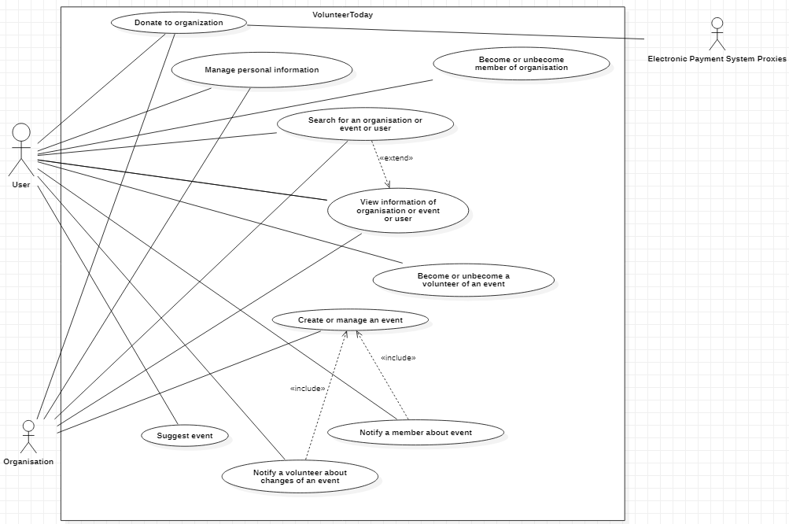
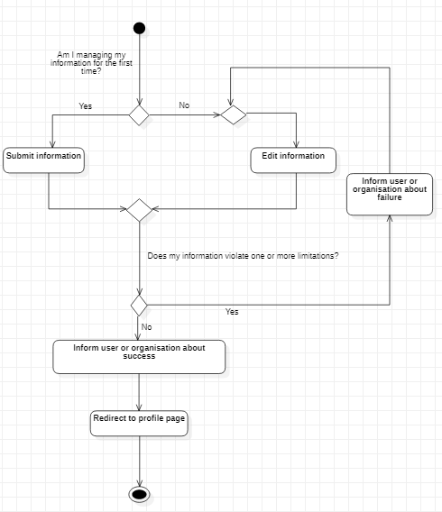
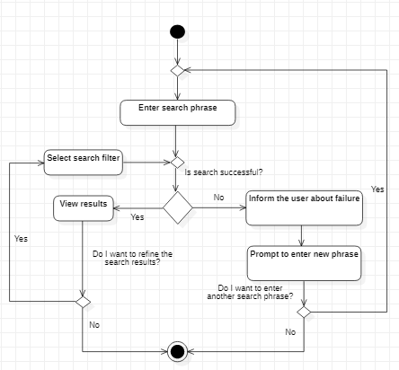
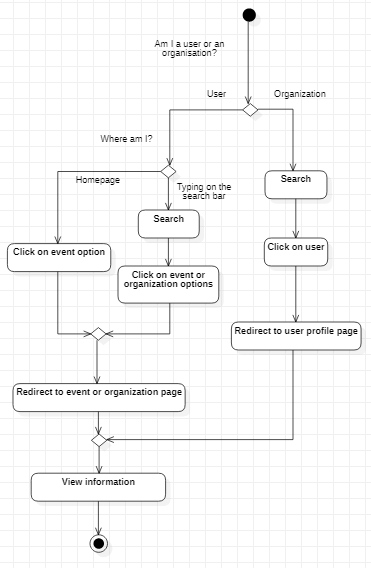
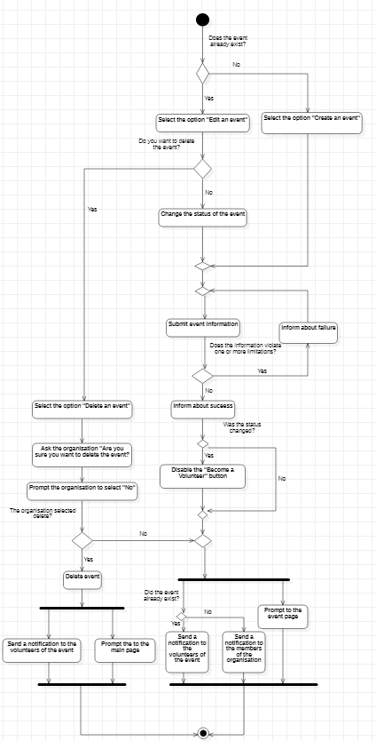
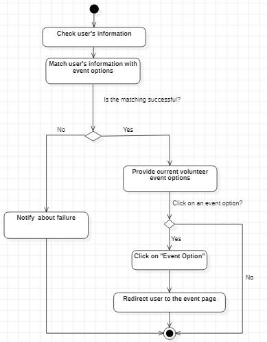
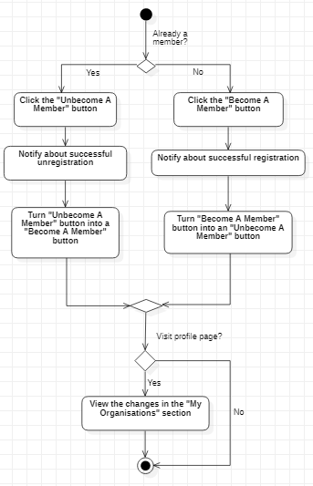
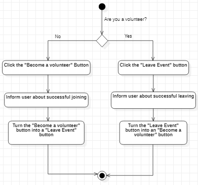
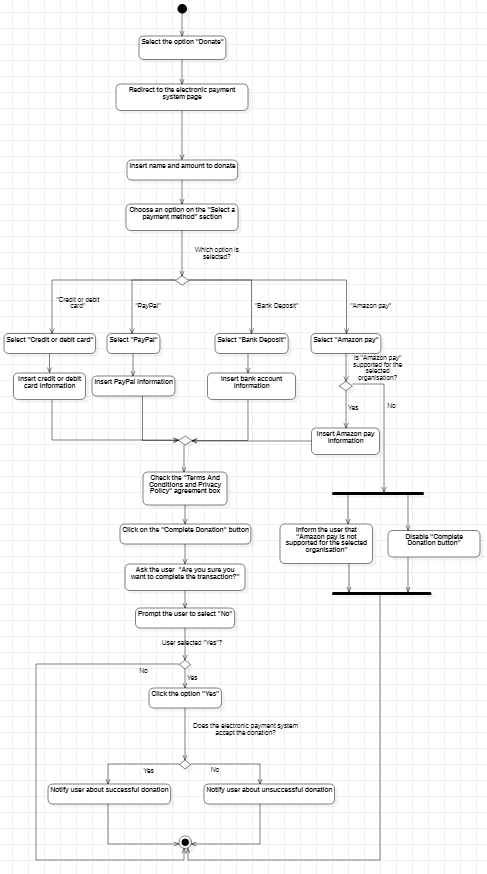

# 2. Use cases

Section 2 of the group's *User Requirements and System Specification* (version 2.0, 11 April 2021): the use-case diagram, and for each use case its scenarios, written in Gherkin, and its activity diagram. The scenarios are also available as feature files in [`features/`](../features).

## 2.1 Use case diagram



The ten use cases are managing personal information, searching, viewing information, creating or managing an event, suggesting events, becoming or unbecoming a member of an organisation, becoming or unbecoming a volunteer of an event, notifying a member about an event, notifying a volunteer about changes to an event, and donating to an organisation. *Create or manage an event* includes the two notification use cases, and *Search* extends *View information*.

## 2.2 Features in Gherkin terminology

Each feature opens with the user story it serves (*as a*, *so that*, *I want*) and names the functional requirement it implements. The values in the scenarios are examples that stand for real input; they are not real people or accounts.

### 2.2.1 Manage personal information

Implements [FR-1](requirements.md#fr-1). Feature file: [`features/ManageUserOrganisationInformation.feature`](../features/ManageUserOrganisationInformation.feature).

```gherkin
# Functional Requirement 1
Feature: Manage personal information
  As a user or organisation
  So that I can manage my account’s personal information
  I want to be able to edit my personal information

  Scenario: Submit information successfully upon signup as a user
    Given that I am a user
    And I have completed my signup
    When I am asked to fill in my information
      | Name            | Maria                                 | minimum 3 characters |                       | required     |
      | Surname         | Nikolaou                              | minimum 3 characters | maximum 99 characters | required     |
      | Age             | 21                                    | maximum of 99        | minimum of 18         | required     |
      | Place of living | Athens                                |                      |                       | not required |
      | Work            | Student                               |                      |                       | not required |
      | Interests       | Fishing, Reading, Environment         |                      |                       | not required |
      | Past Events     | Beach Cleaning Day, Tree Planting Day |                      |                       | not required |
    Then I should be able to complete the information asked
    When I click “Submit”
    Then I should view message saying “Information successfully submitted”
    And I should be redirected to my profile page

  Scenario: Submit information successfully upon signup as an organisation
    Given that I am an organisation
    And I have completed my signup
    When I am asked to fill in my information
      | Name                | Code4Good                   | minimum 3 characters | maximum 99 characters | required     |
      | Founded             | 2021                        |                      | maximum: Today        | not required |
      | Field               | Software, Robotics          |                      |                       | required     |
      | Accepting Donations | no                          |                      |                       | not required |
      | Bank account        | GR1234567891011121314151617 |                      |                       | not required |
    Then I should be able to complete the information asked
    When I click submit
    Then I should view a message saying “Information successfully submitted”
    And I should be redirected to my profile page

  Scenario: Edit information successfully as a user
    Given I am a user
    And I am viewing my profile page
    When I click on the “Manage information” pencil icon
    Then the “Submit Information” prompt card appears
    And I should be able edit the information I want in the respective bars
      | Name            | Maria                                 | minimum 3 characters |                       | required     |
      | Surname         | Nikolaou                              | minimum 3 characters | maximum 99 characters | required     |
      | Age             | 21                                    | maximum of 99        | minimum of 18         | required     |
      | Place of living | Athens                                |                      |                       | not required |
      | Work            | Student                               |                      |                       | not required |
      | Interests       | Fishing, Reading, Environment         |                      |                       | not required |
      | Past Events     | Beach Cleaning Day, Tree Planting Day |                      |                       | not required |
      | Add image       | file                                  |                      |                       |              |
    When I click on the “Submit Information” button
    Then I should view a message saying "Information successfully submitted."
    And I should be redirected to my profile page

  Scenario: Edit information successfully as an organisation
    Given I am an organisation
    And I am viewing my profile page
    When I click on the “Manage information” pencil icon
    Then the “Submit Information” prompt card appears
    And I should be able to edit the information I want in the respective bars
      | Name                | Code4Good                   | minimum 3 characters | maximum 99 characters | required     |
      | Founded             | 2021                        |                      | maximum: Today        | not required |
      | Field               | Software, Robotics          |                      |                       | required     |
      | Accepting Donations | no                          |                      |                       | not required |
      | Bank account        | GR1234567891011121314151617 |                      |                       | not required |
      | Add image           | file                        |                      |                       |              |
    When I click on the “Submit Information” button
    Then I should view a message saying "Information successfully submitted."
    And I should be redirected to my profile page

  Scenario: Submit information unsuccessfully
    Given that I am viewing the “Submit Information” prompt card
    Then I should be able to fill in the information in the bars
    When my information violates one or more limitations
    Then I should view the warning message: "Invalid Information" in #ff0000
    And I should be prompted to enter my information again
```



### 2.2.2 Search for an organisation or event or user

Implements [FR-2](requirements.md#fr-2). Feature file: [`features/SearchOtherUsersOrganisationsEvents.feature`](../features/SearchOtherUsersOrganisationsEvents.feature).

```gherkin
# Functional Requirement 2
Feature: Search for an organisation or event or user
  As a user or organisation
  So that I can check the page of a user or organisation or event’s information
  I want to be able to search for user or organisation or event

  Background:
    Given that I am logged in

  Scenario Outline: User/organisation searching
    When I type "<phrase>" in the search bar
      | phrase        | related      |
      | Code For Good | Code4Good    |
      | Papado        | Papadopoulos |
    And the search phrase "<phrase>" is entered
    Then results for "<phrase>" are shown
      | Age "21"                   | Maria Nikolaou          |
      | Founded "1999"             | Code4Good               |
      | Accepting volunteers "yes" | Greece 2021 Celebration |
    And the related results include "<related>"
    And I should be able to select a search filter
      | Search filter | [“All”, “Events”, “Organisations”, “People” ] |
    When I select a search filter
    Then I should be able to view the filtered results

  Scenario: User/organisation searching failed
    When I type "<phrase>" in the search bar
    And the search phrase "<phrase>" is entered
    But no result matches
    Then I should view a message saying "No results"
    And I should be prompted to enter a new phrase
```



### 2.2.3 View information of organisation or event or user

Implements [FR-3](requirements.md#fr-3). Feature file: [`features/ViewInformationOfOrganisationUserEvent.feature`](../features/ViewInformationOfOrganisationUserEvent.feature).

```gherkin
# Functional Requirement 3
Feature: View information of organisation or event or user
  As a user
  So that I can be informed about the organisations whose events I apply for and about the events themselves
  I want to be able to view information about the organisation and its events

  Background:
    Given that I am logged in

  Scenario: View information about my events as a user in the homepage
    Given that I am a user
    And that I am viewing the homepage
    When I click on one of the event options in “My Events”
    Then I should be redirected to the event page
    And I should be able to view its information
      | Name              | Spring Hackathon | minimum 3 characters                   |                                        |
      | Location          | Online           |                                        |                                        |
      | Date              | 23-25 of April   |                                        |                                        |
      | Special outfit    | Pajamas          |                                        |                                        |
      | Special Equipment | Internet Access  |                                        |                                        |
      | Status            | in progress      | recruiting or in progress or completed | maximum number of states of an event 1 |

  Scenario: View information about an event as a user in an organisation page
    Given that I am a user
    And I am viewing an organisation page and its events
    Then I should be able to click on an event
    And I should be redirected to the event page
    And I should be able to view its information

  Scenario: View information about an event as a user after a search
    Given that I am a user
    And that I have made a search
    And I am viewing the related results
    When I click on an event from the results
    Then I should be redirected to the event page
    And I am viewing its information

  Scenario: View information about an organisation as a user after a search
    Given that I am a user
    And that I have made a search
    And I am viewing the related results
    When I click on an organisation from the results
    Then I should be redirected to the organisation page
    And I should be able to view its information
      | Name                | Code4Good          | minimum 3 characters |
      | Founded             | 2021               |                      |
      | Field               | Software, Robotics |                      |
      | Accepting Donations | no                 |                      |

  Scenario: View information about a user as an organisation after a search
    Given that I am an organisation
    And that I have made a search
    And I am viewing the related results
    When I click on a user from the results
    Then I should be redirected to the user page
    And I should be able to view their information
      | Name            | Maria Nikolaou                        | minimum 3 characters |                       |
      | Surname         | Nikolaou                              | minimum 3 characters | maximum 99 characters |
      | Age             | 21                                    | maximum of 99        | minimum of 18         |
      | Place of living | Athens                                |                      |                       |
      | Work            | Student                               |                      |                       |
      | Interests       | Fishing, Reading, Environment         |                      |                       |
      | Past Events     | Beach Cleaning Day, Tree Planting Day |                      |                       |
```



### 2.2.4 Create or manage an event

Implements [FR-4](requirements.md#fr-4), [FR-7](requirements.md#fr-7), [FR-9](requirements.md#fr-9). Feature file: [`features/CreateManageAnEvent.feature`](../features/CreateManageAnEvent.feature).

```gherkin
# Functional Requirements 4,7,9
Feature: Create or manage an event
  As an organisation
  So that I can create new events and change their information if needed
  I want to be able to create an event and modify its information

  Background:
    Given that I am logged in
    And that I am an organisation

  Scenario: Create an event
    Given I am in my organisation page
    When I select the option "Create an event"
    Then a new event is created
    And I am asked to submit event information
      | Name                         | Spring Hackathon |                                        | minimum 3 characters |
      | Location                     | Online           |                                        |                      |
      | Date                         | 23-25 of April   |                                        |                      |
      | Status                       | in progress      | recruiting or in progress or completed | maximum of 1         |
      | Special Equipment            | [“Yes”, “No”]    |                                        |                      |
      | Add needed special equipment | Internet Access  |                                        |                      |
      | Special outfit               | [“Yes”, “No”]    |                                        |                      |
      | Add needed special outfit    | Pajamas          |                                        |                      |
      | Add image                    | file             |                                        |                      |
      | Add description about event  | text             |                                        |                      |
    And I should view a message saying "New event created"
    And a notification should be sent to the members of the organisation
    And I should be redirected to the event page

  Scenario: Edit an event
    Given an event exists
    And I am viewing the event page
    When I select the option "Edit Event"
    Then I should be allowed to edit information
    And I should be allowed to change the status of the event
    And I am asked to submit event information
    When the status is changed to “in progress” or “completed”
    Then the “Become a volunteer” button is disabled
    When I submit the event information
    Then I should view a message saying "Event successfully edited"
    And a notification should be sent to the volunteers of the event
    And I should be redirected to the event page

  Scenario: Unsuccessfully submitting/editing event information
    Given that I am submitting or editing event information
    When My information violates one or more limitations
    Then I should view a message saying "Invalid Information" in #ff0000
    And I should be prompted to enter the event information again

  Scenario: Delete an event
    Given an event exists
    And I am editing the event
    When I select the option "Delete Event"
    Then I should view a message saying "Are you sure you want to delete the event?"
    Then I should be prompted to select "No"
    When I select "Delete"
    Then the event is deleted
    And I should view a message saying "Event is deleted"
    And I should be redirected to the main page
    And a notification should be sent to the volunteers of the event
    When I select "No"
    Then I should be redirected to the event page
```



### 2.2.5 Suggest event

Implements [FR-5](requirements.md#fr-5). Feature file: [`features/SuggestEvent.feature`](../features/SuggestEvent.feature).

```gherkin
# Functional Requirement 5
Feature: Suggest event
  As a user
  So that I be informed about new current volunteer events that I might be interested in participating
  I want to be suggested new current volunteer events

  Background:
    Given that I am logged in
    And I am a user

  Scenario Outline: Successful information with event matching and corresponding suggestions
    Given I have submitted my personal information
      | Personal information        | (example)                                                  | minimum value        | maximum value         |
      | Name                        | “Ioannis Papadopoulos”                                     | minimum 3 characters | maximum 30 characters |
      | Age                         | 30                                                         | minimum of 18        | maximum of 99         |
      | Location                    | “Athens”                                                   | minimum 3 characters | maximum 30 characters |
      | Profession                  | “Teacher”                                                  | minimum 3 characters | maximum 30 characters |
      | Interests                   | “Hiking”                                                   | minimum 3 characters | maximum 30 characters |
      | History of volunteer events | “Hellenic Rescue Team Expedition in Olympus (summer 2016)” | minimum 3 characters | maximum 30 characters |
    And I am viewing the homepage
    Then the system should be able to check my personal information
    And the system should match my personal information with current event options
      | Event option | “Tree planting in Chortiatis mountain (spring 2019)” | “First aid workshop” |
    And the system should provide me with some event options based on my information
    When I click on an event option
    Then I should be redirected to the event page

  Scenario: Unavailability of new current event options
    Given I have inserted my personal information
    And I am viewing the homepage
    Then the system should be able to check my personal information
    And my information should be matched to events
    When the matching is not successful
    Then I should view the message “No current events available”
```



### 2.2.6 Become or Unbecome member of organisation

Implements [FR-6](requirements.md#fr-6). Feature file: [`features/BecomeUnbecomeAMember.feature`](../features/BecomeUnbecomeAMember.feature).

```gherkin
# Functional Requirement 6
Feature: Become or Unbecome member of organisation
  As a user
  So that I can be notified about new current volunteer events from a specific organisation
  I want to be able to become a member

  Background:
    Given that I am logged in
    And that I am a user

  Scenario Outline: Become a member successfully
    Given that I am viewing the organisation profile page
    When I click on the “Become A Member” button
    Then I should receive the notification “You are now a member of the organization “<organization name>””
      | Organization name | "Red Cross Greece" |
    And the “Become A Member” button turns into an “Unbecome A Member” button
    When I visit my profile page
    Then I should be able to view the new “<organisation name>” in the “My Organisations” section

  Scenario Outline: Unbecome a member
    Given that I am viewing the organisation page
    When I click on the “Unbecome A Member” button
    Then I should receive the notification “You are not a member of the organization “<organization name>” anymore. You will be missed!”
    And the “Unbecome A Member” button turns into a “Become A Member” button
    When I visit my profile page
    Then I should be able to view that the new “<organisation name>” is removed from the “My Organisations” section
```



### 2.2.7 Become or Unbecome a volunteer of a current event

Implements [FR-8](requirements.md#fr-8). Feature file: [`features/ApplyForEvent.feature`](../features/ApplyForEvent.feature).

```gherkin
# Functional Requirement 8
Feature: Become or unbecome a volunteer of a current event
  As a user
  So that I can participate in new current volunteer events or withdraw from events I am already a volunteer of
  I want to be able to become a volunteer of a current volunteer event

  Background:
    Given that I am logged in
    And that I am a user
    And that I am viewing the event page
      | Name              | "Loutraki beach Cleaning Day" |
      | Location          | “Loutraki beach”              |
      | Date              | 30/10/2020                    |
      | Special Outfit    | "not needed"                  |
      | Special Equipment | "not needed"                  |
      | Status            | recruiting                    |

  Scenario Outline: Become a volunteer of a current volunteer event
    Given the event is current
    When I click the “Become a volunteer” button
    Then I should receive the notification “You have successfully become a volunteer for the event “<event name>””.
    And the “Become a volunteer” button turns into a “Unbecome a volunteer” button

  Scenario Outline: Unbecome a volunteer of an event
    Given I have become a volunteer for an event
    When I click the “Unbecome a volunteer” button
    Then I should receive the notification “You have unbecome a volunteer for the event “<event name>”. You will be missed!”
    And the “Unbecome a volunteer” button turns into an “Become a volunteer” button
```



### 2.2.8 Donate to organisation

Implements [FR-10](requirements.md#fr-10). Feature file: [`features/DonateToOrganisation.feature`](../features/DonateToOrganisation.feature).

```gherkin
# Functional Requirement 10
Feature: Donate to organisation
  As a user
  So that I can support an organisation financially
  I want to be able to make a donation

  Background:
    Given that I am logged in
    And I am a user
    And I am viewing the profile of an organisation

  Scenario: Successful donation via credit or debit card
    When I click on “Make a donation” button
    Then I am redirected to the Donation page
    When I insert my name and amount to donate
    And I select “Credit or debit card” on the “Select a payment method” section
    And I insert my credit or debit card information
      | Card number      | 123456789123456 |
      | Card expiry date | 10/25           |
      | Security code    | 789             |
      | ZIP/Postal Code  | 54630           |
    And I check the Terms And Conditions and Privacy Policy agreement box
    And I click on the “Complete Donation” button
    Then I am asked to confirm my donation
    When I click the option “Yes”
    And the electronic payment system accepts the donation
    Then I get a notification about the successful donation

  Scenario: Successful donation via PayPal
    When I click on the “Make a donation” button
    Then I am redirected to the Donation page
    When I insert my name and amount to donate
    And I select “PayPal” on the “Select a payment method” section
    And I insert my PayPal information
      | PayPal email address | donor@example.com |
      | PayPal phone number  | 12345678910       |
    And I check the Terms And Conditions and Privacy Policy agreement box
    And I click on the “Complete Donation” button
    Then I am asked to confirm my donation
    When I click the option “Yes”
    And the electronic payment system accepts the donation
    Then I get a notification about the successful donation

  Scenario: Successful donation via Amazon pay
    When I click on the “Make a donation” button
    Then I am redirected to the Donation page
    When I insert my name and amount to donate
    And I select “Amazon pay” on the “Select a payment method” section
    And I insert my Amazon pay information
      | Amazon pay email address or phone number | donor@example.com                   | 12345678910 |
      | Amazon pay password                      | example-password (****************) | -           |
    And I check the Terms And Conditions and Privacy Policy agreement box
    And I click on the “Complete Donation” button
    Then I am asked to confirm my donation
    When I click the option “Yes”
    And the electronic payment system accepts the donation
    Then I get a notification about the successful donation

  Scenario: Donations via Amazon pay are not supported by the organisation
    Given that the selected organisation does not support Amazon pay
    When I click on the “Make a donation” button
    Then I am redirected to the Donation page
    When I insert my name and amount to donate
    And I select “Amazon pay” on the “Select a payment method” section
    Then I am informed that “Amazon pay is not supported for the selected organisation”
    And the “Complete Donation button” is disabled

  Scenario: Successful donation via Bank Deposit
    When I click on the “Make a donation” button
    Then I am redirected to the Donation page
    When I insert my name and amount to donate
    And I select “Bank Deposit” on the “Select a payment method” section
    And I insert my bank account information
      | IBAN | 12345678910111213141516171819 |
      | PIN  | 1234 (****)                   |
    And I check the Terms And Conditions and Privacy Policy agreement box
    And I click on the “Complete Donation” button
    Then I am asked to confirm my donation
    When I click the option “Yes”
    And the electronic payment system accepts the donation
    Then I get a notification about the successful donation

  Scenario: Unsuccessful donation
    When I click on the “Make a donation” button
    Then I am redirected to the Donation page
    When I insert my name and amount to donate
    And I select an option on the “Select a payment method” section
      | Payment method option | [“Credit or debit card”, “PayPal”,“Amazon pay”, “Bank Deposit”] |
    And I insert the corresponding information
    And I check the Terms And Conditions and Privacy Policy agreement box
    And I click on the “Complete Donation” button
    Then I am asked to confirm my donation
    When I click the option “Yes”
    And the electronic payment system declines the donation
    Then I get a notification about the unsuccessful donation
```



---

Previous: [1. System requirements](requirements.md) · Next: [3. UI mock-ups](ui-mockups.md)
